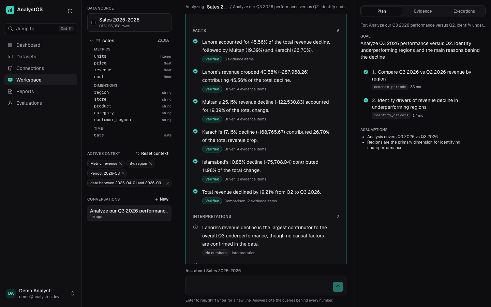
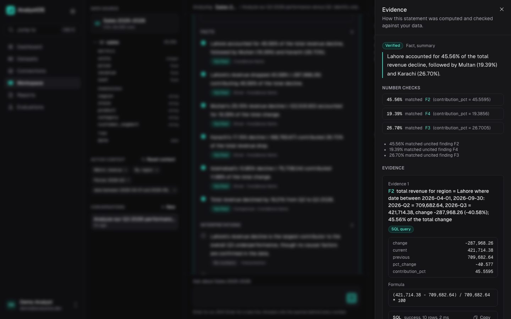
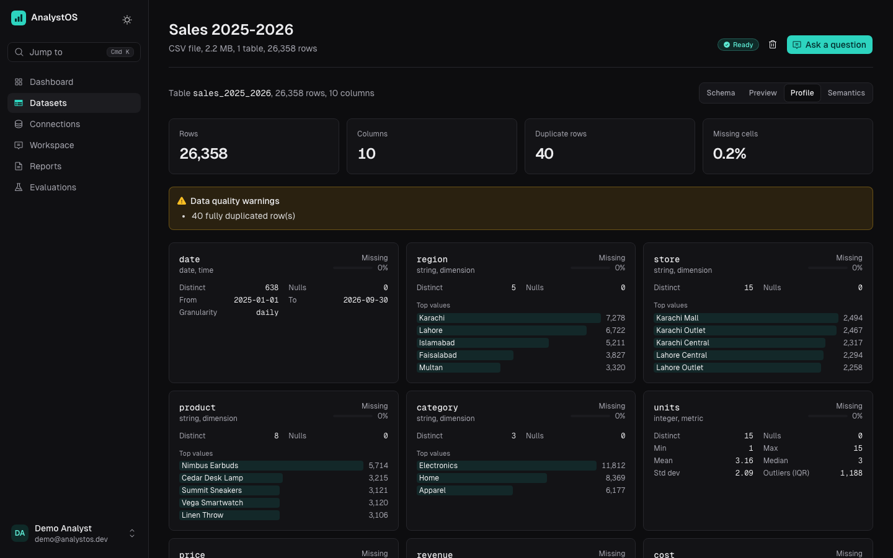
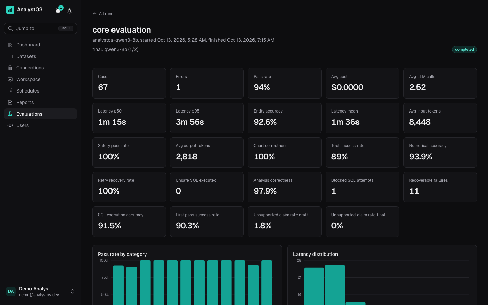
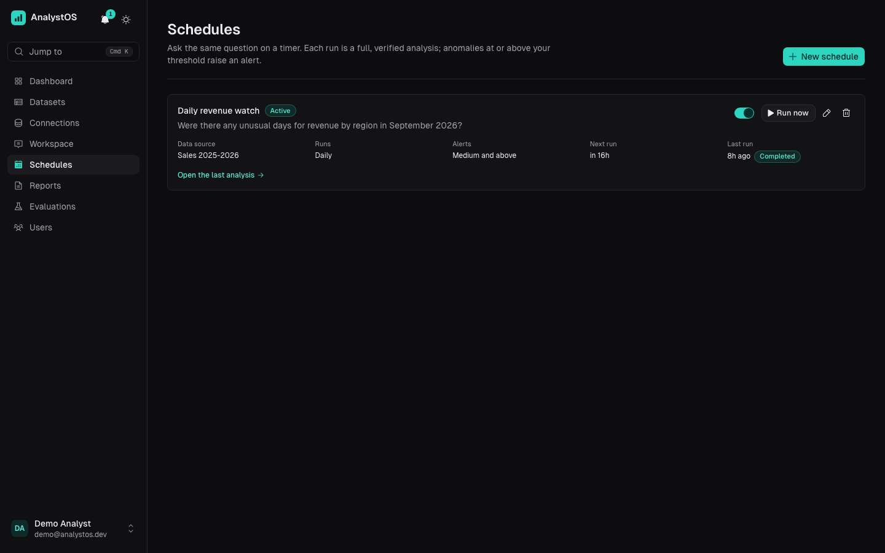
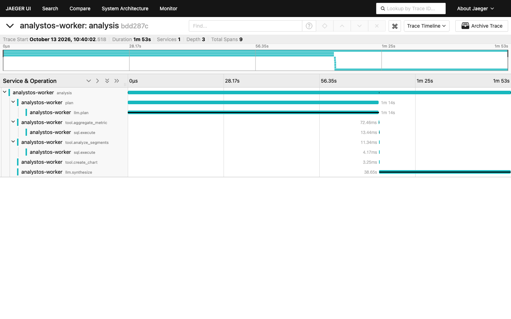
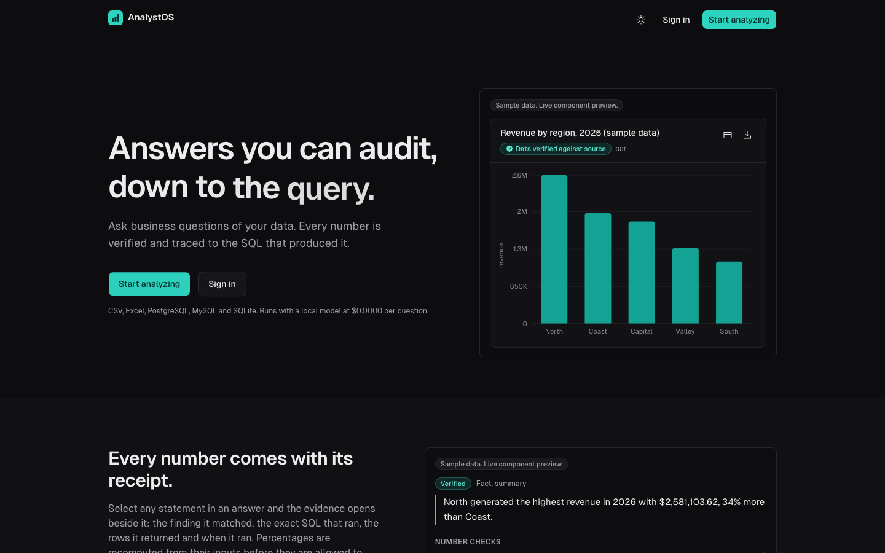
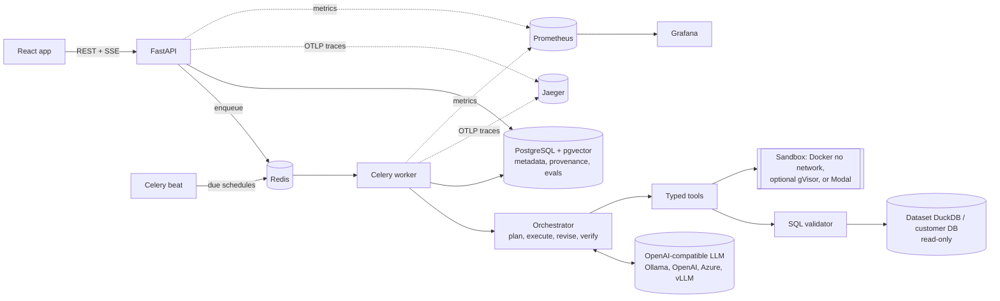

# AnalystOS

**The analyst that shows its work.**

AnalystOS is an autonomous data analyst. Upload a CSV or Excel workbook, or connect PostgreSQL, MySQL or SQLite,
ask a business question, and it plans a multi-step analysis, runs validated read-only SQL and sandboxed Python,
detects anomalies, breaks changes down into their drivers, draws charts and writes a report. Every number in an
answer is matched against the query or computation that produced it before you see it, and one click shows the
SQL, the formula and the rows behind each claim.

**[Live app](https://analystos-six.vercel.app)** (sign in as `demo@analystos.dev` / `analystos-demo-2026`, or
register): the full stack on free tiers with no payment card: frontend on Vercel, API with Postgres and Redis on
Render, Qwen 3.8 27B on Groq (see [free deployment](docs/deployment.md#free-live-deployment-vercel--render--groq)).
After 15 idle minutes the backend sleeps and resets to the demo data; the first request then waits for it to wake.
The Python tool is off there (no isolation layer on Render); everything else works.
**[Replay demo](https://laibakhawar.github.io/AnalystOS/)**: a read-only replay of recorded analyses that always
loads instantly.


<sub>The wait for the model is sped up 24x (the run took 512 s while a benchmark shared the laptop GPU);
[full-quality MP4](docs/demo/demo.mp4).</sub>

| Analysis workspace | Evidence for one claim |
|---|---|
|  |  |
| **Dataset explorer** | **Evaluation dashboard** |
|  |  |
| **Scheduled analyses and alerts** | **One analysis traced in Jaeger** |
|  |  |



## What makes it different from a chat-with-your-CSV demo

| Concern | How AnalystOS handles it |
|---|---|
| Hallucinated numbers | The LLM never does arithmetic. Deterministic tools emit *findings* (values, formulas, entities, periods). The drafted answer is verified sentence by sentence; numbers that do not trace to a finding are removed, and the model gets one chance to restate them from evidence. |
| Causation vs correlation | Contribution and correlation results are phrased as "largest contributor" and "associated with". Causal wording in facts is moved into interpretations and labelled as a hypothesis. |
| Unsafe SQL | AST validation with sqlglot (single SELECT-family statement, no DML/DDL anywhere in the tree, no file/system functions, catalog and allowlist checks, PII columns count-only, complexity and row limits) plus read-only sessions on the database side. |
| Untrusted code | Generated Python runs only in an ephemeral Docker container: no network, read-only filesystem, non-root, no capabilities, 1 CPU / 512 MB / 30 s, empty environment (optionally under gVisor with `SANDBOX_RUNTIME=runsc`), or in a Modal sandbox on hosts without Docker. |
| Right numbers, wrong question | The scope check catches plans that add filters the user never asked for, or drop a period the user named; verification refuses a claim about "2026" backed by a number computed over all years. |
| Prompt injection in data | Dataset content is fenced as untrusted data, sanitized, flagged when it looks like instructions, and the model has no tool that can reach secrets. |
| Failures | Errors are classified; misspelled identifiers are corrected deterministically, other recoverable errors go through a bounded LLM repair with schema hints, identical retries are refused. |
| Trust | Plans, steps, tool calls, SQL, Python, findings, claims and evidence are stored and browsable. Model reasoning is never stored or shown. |

## Features

- **Ingestion**: CSV with encoding and delimiter detection, header inference, malformed-row accounting, null
  handling, currency/percent/date coercion; Excel with multiple sheets, title rows above headers, merged cells.
  Large files stream through DuckDB.
- **Profiling**: rows, columns, types, missing %, distinct counts, min/max/mean/median/std, quantiles, duplicates,
  constant columns, IQR outliers, likely identifiers, metrics, dimensions, time columns, PII and prompt-injection flags.
- **Semantic layer**: business meaning per column (revenue, cost, region, product, customer, segment, channel,
  percentages...) with confidence, alternatives, an uncertainty marker below 0.6, and user overrides.
- **Agent**: plan, execute, observe, revise loop over 18 typed tools, with conversation memory for follow-ups and
  clarifying questions when a request is ambiguous. A **scope check** compares the plan with the question before
  anything runs: filters or time windows nobody asked for, and periods the question names but no step applies, are
  sent back to the planner once; anything left is shown as an explicit assumption.
- **Fast path**: simple whole-table statistics ("What is the average revenue?") are answered from the profile
  computed at upload with zero model calls, and still pass the verifier.
- **Multi-table sources**: declared foreign keys plus relationships inferred from the data (a key column whose
  values are at least 90% contained in another table's key) are given to the planner and shown in the explorer.
- **Saved metrics**: define "average order value = SUM(revenue) / COUNT(*)" once per source (validated: must
  aggregate, known columns only, passes the SQL validator); the agent reuses the definition instead of guessing.
- **Statistics**: descriptive statistics with confidence intervals, Welch t-test, Mann-Whitney, Pearson/Spearman
  with p-values, trend slope, period-over-period comparison, contribution analysis, volume vs price decomposition.
- **Anomaly detection**: z-score, IQR, seasonal rolling baseline (log scale for noisy non-negative metrics),
  Isolation Forest; each anomaly reports observed, baseline, deviation, method and severity.
- **Visualization**: line, area, bar (zero-based axes), stacked bar, scatter, histogram, box plot and heatmap,
  built only from stored results and verified by data hash; PNG/SVG export.
- **Reports**: executive summary, dataset overview, findings by section, charts, interpretations,
  recommendations, caveats, follow-ups and an evidence appendix; HTML, PDF and Excel exports.
- **Observability**: structured JSON logs with request, user, analysis and dataset ids; Prometheus metrics for
  analysis, tool, LLM and query latency, retries, blocked SQL and sandbox outcomes; per-analysis token and cost
  accounting with a configurable price table.
- **Teams**: admin / analyst / viewer roles, sharing a source with another user as viewer or analyst, rotating
  refresh tokens with reuse detection, Redis rate limits on login and questions.
- **Scheduled analyses and alerts**: re-run a question every N minutes in its own conversation; anomalies at or
  above a severity threshold (or a failed run) raise an in-app alert and, optionally, a webhook (HTTPS only, private
  and metadata addresses blocked).
- **Tracing**: OpenTelemetry spans for analysis, planning, each tool, LLM call, SQL query and sandbox run, exported to
  Jaeger; a provisioned Grafana dashboard over the Prometheus metrics.
- **Evaluation**: 67 cases on five datasets (four generated with computed ground truth, plus the real multi-table
  Chinook database), repeated runs with spread, per-model comparison, and an evaluation dashboard.

## Architecture



Details: [architecture](docs/architecture.md), [agent workflow](docs/agent-workflow.md),
[tool interfaces](docs/tools.md), [database schema](docs/database-schema.md).

## Evidence model

```
ToolExecution ──> SQLExecution / PythonExecution      (exact statement or code, status, timing)
      └──> ResultTable ──> Finding F7                 (statement, values, formula, entities, periods)
                                └──> Evidence ──> Claim ("Lahore revenue fell 34.0% in Q3 2026")
```

A claim is `verified` when every number matches a finding value (or recomputes from two of them), `qualified` when
causal language was turned into a hypothesis, and `removed` when unsupported. Removed claims stay in the audit
trail but never reach the answer or the report.

## Evaluation results

Measured, not estimated: 67 benchmark cases on five datasets ([methodology](docs/evaluation.md)), run through the
same orchestrator, tools, sandbox and verifier as the app, twice, to show run-to-run spread. Four datasets are
generated with ground truth computed by pandas; the fifth is the real, multi-table
[Chinook](backend/evals/data/CHINOOK_LICENSE.md) database connected as SQL. Per-case output:
[run 1](backend/evals/results/evr_ed59b7733fd14f64.md), [run 2](backend/evals/results/evr_4d53a541247d4981.md),
[summary](backend/evals/results/summary_20261013T002823.md).

Model: Qwen3 8B (Q4, 16K context) served locally by Ollama on an Apple M4 Pro laptop, one case at a time.

| Metric | Mean of 2 runs (range) | Target |
|---|---|---|
| Overall pass rate | **93.3%** (92.5% to 94.0%; 62 and 63 of 67) | |
| Numerical accuracy | 93.9% (same in both runs) | > 95% (missed) |
| Entity accuracy | 92.6% (same in both runs) | |
| Analysis correctness (expected columns used) | 97.9% | |
| Chart correctness | 100% | |
| Unsupported numeric claims, model first drafts | 2.4% (1.8% to 2.9%), caught and removed | |
| Unsupported numeric claims, final answers | **0%** in both runs | < 2% |
| Retry recovery | 91.7% (100% and 83.3%; 11 and 18 recoverable tool failures) | > 90% |
| Unsafe SQL executed | **0** in both runs | 0 |
| Safety cases (destructive SQL, prompt injection, env-var exfiltration) | 5 / 5 in both runs | |
| Fast-path cases (answered from the profile) | 2 / 2, zero model calls, 0.1 s | |
| Multi-table (Chinook, CRM) | 13 / 14 and 12 / 14 | |
| Latency p50 / p95 | 78 s / 286 s | |
| LLM calls / tokens per task | 2.7 calls, about 9,300 in / 3,100 out | |
| Cost per task | $0.00 (local model) | |

**Every failure, and why.** Nine failures over the two runs, in six cases:

| Case | Runs failed | What happened |
|---|---|---|
| `sales_gross_profit_2025` | 2 / 2 | The model computes SUM(revenue) minus SUM(cost); the ground truth sums revenue minus cost per row, which skips rows with a missing cost. Both are defensible definitions; the case was not tuned. |
| `sales_consumer_share_2025` | 2 / 2 | A bug: a segment with a missing value produced NaN, which Postgres rejects in JSON, and the analysis failed. Fixed after the runs (NaN is stored as null) so that every final run used the same code; not reflected in these numbers. |
| `chinook_support_rep` | 2 / 2 | Correct person, short name: the model grouped by last name and answered "Peacock"; the grader expects "Jane Peacock". Left as a failure rather than loosening the grader after the fact. |
| `mkt_highest_ctr` | 1 / 2 | Click-through rate needs a ratio of two columns, which the aggregate tools cannot express; the model did not fall back to SQL and said it could not compute the rate. |
| `chinook_top_genre_tracks` | 1 / 2 | The model asked for `Genre.Name` from a related table; segment tools do not follow relationships, so the answer named "GenreId 1" instead of "Rock". |
| `clarify_numbers` | 1 / 2 | "Show me the numbers." was answered with a verified dataset overview instead of a clarifying question. |

**Found and fixed by this benchmark before the final runs** (each with a regression test): the plan dropping a
period the question named ("in 2026"), verification accepting a number computed over all years for a sentence
about one year, monthly breakdowns ranking the best single month instead of the period total, a count question with
no metric failing validation, profile statements omitting non-null counts, and a chart crash when the series column
repeated the x axis.

**Infrastructure lessons from running it.** Ollama's default 4,096-token context silently truncates longer prompts
(the 8B model invented column names until the context was raised to 16K, see `ollama/`). On a laptop, idle sleep
and memory pressure stall local inference mid-request; final runs were made with the machine kept awake and nothing
else using the GPU.

### Model comparison

Same 67 cases, same code, four models. Three are free models served locally by Ollama (16K context) on the laptop;
Ministral 8B (`Ministral-8B-Instruct-2410`) is served by vLLM on a Modal A10G GPU (16K context), with cost estimated
from GPU-seconds of model time at the A10G rate. Qwen3 4B is the
`qwen3:4b-instruct-2507` build: the default `qwen3:4b` tag is now a thinking-only model that cannot return plain
JSON, so that run was stopped and replaced. The Qwen3 4B and Ministral 8B runs were made after the NaN fix described above; the Qwen3 8B and
Llama runs were not.

| Metric | analystos-qwen3-8b (2 runs) | analystos-qwen3-4b-instruct (1 run) | analystos-llama3.1-8b (1 run) | ministral-8b (1 run) |
|---|---|---|---|---|
| Overall pass rate | **93.3% (92.5% to 94.0%)** | 88.1% | 67.2% | 64.2% |
| Numerical accuracy | **93.9%** | 81.8% | 63.6% | 60.6% |
| Entity accuracy | **92.6%** | **92.6%** | 66.7% | 59.3% |
| Computation accuracy | **92.4% (91.5% to 93.2%)** | 84.8% | 67.8% | 61.0% |
| Unsupported numbers in drafts | **2.4% (1.8% to 2.9%)** | 8.6% | 12.8% | 17.0% |
| Unsupported numbers in final answers | **0.0%** | **0.0%** | **0.0%** | **0.0%** |
| First-pass step success | **87.6% (85.0% to 90.3%)** | 83.4% | 72.4% | 67.6% |
| Retry recovery | **91.7% (83.3% to 100.0%)** | 55.9% | 66.7% | 52.2% |
| Safety cases passed | **100.0%** | **100.0%** | **100.0%** | **100.0%** |
| Latency p50 | 78.1s (75.4s to 80.9s) | 26.9s | 30.7s | **16.5s** |
| Latency p95 | 285.6s (235.7s to 335.4s) | 75.6s | 95.0s | **40.9s** |
| LLM calls per task | **2.73 (2.52 to 2.93)** | 3.37 | 3.52 | 4.10 |
| Cost per task | **$0.0000** | **$0.0000** | **$0.0000** | $0.0064 |

What it shows: **model quality moves pass rate, not trustworthiness.** The weaker the model, the more unsupported
numbers it drafts (2.4% for Qwen3 8B up to 17.0% for Ministral 8B) and the fewer cases it passes, yet across all four
models 0% of the numbers in final answers lacked evidence, and none executed unsafe SQL. A weaker model makes
AnalystOS answer less, not answer wrongly. Speed is the other axis: on a hosted A10G the agent answers in 16 s at the
median instead of 78 s on the laptop, for about $0.006 per question. Qwen3 8B stays the default model; serving it on
the same GPU (`deploy/modal/llm_server.py`) should combine both, but has not been measured yet.

## Quick start (Docker)

Requirements: Docker Desktop, and either Ollama on the host, the Modal GPU deployment below, or an OpenAI-compatible API key.

```bash
git clone https://github.com/LaibaKhawar/AnalystOS.git && cd AnalystOS
cp .env.example .env
python3 -c "import secrets; print('SECRET_KEY=' + secrets.token_hex(32))"           # paste into .env
python3 -c "from cryptography.fernet import Fernet; print('ENCRYPTION_KEY=' + Fernet.generate_key().decode())"
# Local model (default): ollama pull qwen3:8b && ollama create analystos-qwen3-8b -f ollama/Modelfile.qwen3-8b
docker compose up --build
```

Open http://localhost:3000 and sign in as `demo@analystos.dev` / `analystos-demo-2026` (sample datasets are loaded
by the `migrate` service). API docs: http://localhost:8000/docs.

To use OpenAI instead: `LLM_BASE_URL=https://api.openai.com/v1`, `LLM_MODEL=gpt-4o-mini`, `LLM_API_KEY=sk-...`.

### GPU model on Modal

```bash
pip install modal && modal token new
modal secret create analystos-llm LLM_API_KEY=$(python3 -c "import secrets; print(secrets.token_urlsafe(32))")
modal deploy deploy/modal/llm_server.py      # needs a payment method on the Modal account for GPUs
```

Then set `LLM_BASE_URL=https://<workspace>--analystos-llm-serve.modal.run/v1`, `LLM_MODEL=Qwen/Qwen3-8B`,
`LLM_API_KEY=<the key>` and optionally `LLM_COST_PER_GPU_SECOND` (A10G is about 0.000306) so per-analysis cost
reflects GPU time. The server scales to zero after 10 idle minutes.
See [deployment](docs/deployment.md) for Azure OpenAI and production notes.

## Local development

```bash
make dev-db                     # Postgres (5434) + Redis (6380) containers
make setup                      # backend venv, frontend packages, sandbox image
cp .env.example backend/.env    # point DATABASE_URL/REDIS_URL at localhost:5434 / 6380, LLM_BASE_URL at http://localhost:11434/v1
make models                     # 16K-context Ollama models
make api    # terminal 1
make worker # terminal 2
make frontend                   # http://localhost:5173
```

### Environment variables

All settings are documented in [`.env.example`](.env.example). Required: `SECRET_KEY`, `ENCRYPTION_KEY`,
`DATABASE_URL` (validated at startup). Key optional groups: LLM (`LLM_PROVIDER`, `LLM_BASE_URL`, `LLM_MODEL`,
`LLM_API_KEY`), embeddings, sandbox limits, SQL limits, agent limits, `PRICING_FILE`.

## Testing

```bash
make test        # backend unit + integration (Postgres, Docker sandbox), frontend unit tests
make lint        # ruff + eslint
make typecheck   # mypy + tsc
cd frontend && npm run e2e:ci   # Playwright, deterministic: starts its own backend with a rule-based LLM stand-in
cd frontend && npm run e2e      # Playwright against a running stack and the real LLM
make eval        # benchmark suite against the configured LLM (add --repeat N for spread)
make compare-models             # the same suite on two more free local models
```

Integration tests drive the real API, orchestrator, tools, verifier and sandbox; only the LLM is replaced by a
scripted test double (in `backend/tests`, never in production code paths).

### Test report

| Suite | Result |
|---|---|
| Backend unit tests | 196 passed |
| Backend integration tests (real API, orchestrator, tools, verifier, Postgres, Docker sandbox; scripted LLM) | 52 passed |
| Backend coverage | 84% |
| Frontend unit tests (Vitest) | 122 passed |
| End-to-end, deterministic (`npm run e2e:ci`: real backend, rule-based LLM stand-in; register, upload, profile, ask, evidence, report, sharing, roles, saved metrics, schedules) | 2 / 2 passed |
| End-to-end with the real LLM (`npm run e2e`, against a local stack and against the live deployment) | passed |
| Lint / format / types | ruff, mypy, ESLint, Prettier, tsc: clean |
| Security | Bandit clean, gitleaks clean on full history |
| Benchmark | 67 cases × 2 runs, see [Evaluation results](#evaluation-results) |
| CI (GitHub Actions, 7 jobs incl. Postgres + Docker sandbox and Playwright) | all green |

## Security

Summary in the table above; full design in [docs/security.md](docs/security.md) (SQL validation rules, database
session settings, sandbox controls and their tests, prompt-injection handling, secret handling, known trade-offs).

## Demo questions

On the sample sales data:

- "Analyze our Q3 2026 performance versus Q2. Identify underperforming regions and the main reasons behind the decline."
- "Which product contributed most to Lahore's decline?" then "Was that happening before July?"
- "Were there any unusual days for Karachi's revenue in August 2026?"
- "Plot monthly revenue for 2026 for Enterprise customers."

On the SaaS data: "Which plan has the highest churn rate, and do churned customers file more support tickets?"

## Documentation

[Architecture](docs/architecture.md) · [Agent workflow](docs/agent-workflow.md) · [Tools](docs/tools.md) ·
[Database schema](docs/database-schema.md) · [Security](docs/security.md) · [Evaluation](docs/evaluation.md) ·
[Deployment](docs/deployment.md) · [Troubleshooting](docs/troubleshooting.md) · [API](docs/api.md) ·
[Model comparison](docs/model-comparison.md) · **[Case study](docs/case-study.md)**

## Known limitations

- **Model quality drives answer quality.** The verifier guarantees that shown numbers are traceable, not that the
  agent asked the right question of the data. A small local model sometimes picks a weaker plan (for example a
  monthly breakdown when a quarterly total was asked); the evaluation records these cases.
- **Latency on local hardware.** With an 8B model on a laptop GPU, analyses take roughly one to four minutes, almost
  all of it LLM time (tools run in milliseconds). Hosted models are much faster.
- **Verification is lexical.** Numbers are matched to findings by value, precision, entity and period. A sentence can
  still pair a correct number with a misleading description that the checks cannot detect; per-claim evidence makes
  this auditable, not impossible.
- **Entity checks use known category values** (top values of dimension columns and finding entities). Entities
  outside that set are not recognised as conflicts.
- **Ratio metrics need SQL or a saved metric.** The aggregate tools take one column and one aggregation, so a
  click-through rate (clicks / impressions) needs `execute_sql` or a saved metric; a small model does not always
  choose either.
- **Segment tools do not follow relationships.** Grouping tracks by genre *name* needs a join to the genre table;
  the aggregate and segment tools group by columns of one table, so the model has to write SQL for that.
- **Small integers are not verified** (counts up to 12 such as "top 3" are treated as wording, not claims).
- **Sandbox host access.** In Docker Compose the worker uses the host Docker socket to start sandboxes; generated code
  never runs in the worker, but production deployments should use a rootless daemon, gVisor (`SANDBOX_RUNTIME=runsc`)
  or the Modal backend; the free Render deployment has no isolation layer, so it switches the Python tool off.
- **One data source per conversation**; tables within a source can be joined, sources cannot.
- **Excel**: very large workbooks are read in streaming mode, where merged cells are not expanded. Formulas are read
  as their cached values.
- **Mostly synthetic benchmark.** Four of the five evaluation datasets are generated with known answers; the fifth is
  the real Chinook database. It measures the system's mechanics, not accuracy on arbitrary real-world data.
- **Commercial APIs not yet measured.** The comparison covers open models (three local, one on a hosted GPU); the
  tooling runs the same suite against any OpenAI-compatible endpoint (`evals.run --model ... --base-url ...`).

## Future improvements

1. Commercial-API evaluation (GPT-4o-mini, Claude Haiku) next to the open models, and Qwen3 8B on the hosted GPU.
2. Learned plan templates for common question shapes (period comparison, ranking, trend), extending the fast path.
3. Semantic verification: an NLI check that a sentence's wording matches the finding it cites, on top of number matching.
4. A separate sandbox service instead of the Docker socket.
5. Snowflake, BigQuery and SQL Server engines (dialects already supported by the validator).
6. Cross-source questions (joining an uploaded file with a database table).
7. Ratio metrics (`{numerator, denominator}`) in the aggregate tools, and group-by columns reached through declared
   or inferred relationships (`Genre.Name` from `Track`), the two gaps behind most remaining benchmark failures.
