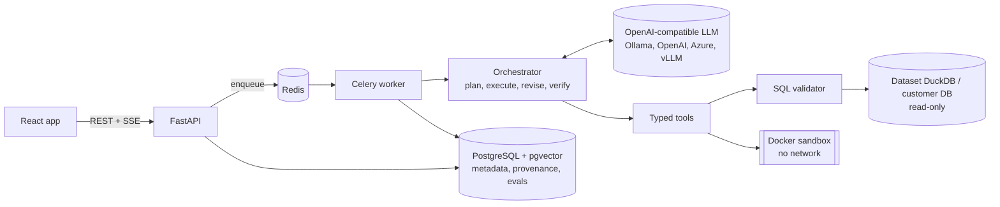

# AnalystOS

**The analyst that shows its work.**

AnalystOS is an autonomous data analyst. Upload a CSV or Excel workbook, or connect PostgreSQL, MySQL or SQLite,
ask a business question, and it plans a multi-step analysis, runs validated read-only SQL and sandboxed Python,
detects anomalies, breaks changes down into their drivers, draws charts and writes a report. Every number in an
answer is matched against the query or computation that produced it before you see it, and one click shows the
SQL, the formula and the rows behind each claim.

| Analysis workspace | Evidence for one claim |
|---|---|
|  |  |
| **Dataset explorer** | **Evaluation dashboard** |
|  |  |


## What makes it different from a chat-with-your-CSV demo

| Concern | How AnalystOS handles it |
|---|---|
| Hallucinated numbers | The LLM never does arithmetic. Deterministic tools emit *findings* (values, formulas, entities, periods). The drafted answer is verified sentence by sentence; numbers that do not trace to a finding are removed, and the model gets one chance to restate them from evidence. |
| Causation vs correlation | Contribution and correlation results are phrased as "largest contributor" and "associated with". Causal wording in facts is moved into interpretations and labelled as a hypothesis. |
| Unsafe SQL | AST validation with sqlglot (single SELECT-family statement, no DML/DDL anywhere in the tree, no file/system functions, catalog and allowlist checks, PII columns count-only, complexity and row limits) plus read-only sessions on the database side. |
| Untrusted code | Generated Python runs only in an ephemeral Docker container: no network, read-only filesystem, non-root, no capabilities, 1 CPU / 512 MB / 30 s, empty environment. |
| Prompt injection in data | Dataset content is fenced as untrusted data, sanitized, flagged when it looks like instructions, and the model has no tool that can reach secrets. |
| Failures | Errors are classified; misspelled identifiers are corrected deterministically, other recoverable errors go through a bounded LLM repair with schema hints, identical retries are refused. |
| Trust | Plans, steps, tool calls, SQL, Python, findings, claims and evidence are stored and browsable. Model reasoning is never stored or shown. |

## Features

- **Ingestion**: CSV with encoding and delimiter detection, header inference, malformed-row accounting, null
  handling, currency/percent/date coercion; Excel with multiple sheets, title rows above headers, merged cells.
  Large files stream through DuckDB.
- **Profiling**: rows, columns, types, missing %, distinct counts, min/max/mean/median/std, quantiles, duplicates,
  constant columns, IQR outliers, likely identifiers, metrics, dimensions, time columns, PII and prompt-injection flags.
- **Semantic layer**: business meaning per column (revenue, cost, region, product, customer, segment, channel,
  percentages...) with confidence, alternatives, an uncertainty marker below 0.6, and user overrides.
- **Agent**: plan, execute, observe, revise loop over 17 typed tools, with conversation memory for follow-ups and
  clarifying questions when a request is ambiguous.
- **Statistics**: descriptive statistics with confidence intervals, Welch t-test, Mann-Whitney, Pearson/Spearman
  with p-values, trend slope, period-over-period comparison, contribution analysis, volume vs price decomposition.
- **Anomaly detection**: z-score, IQR, seasonal rolling baseline (log scale for noisy non-negative metrics),
  Isolation Forest; each anomaly reports observed, baseline, deviation, method and severity.
- **Visualization**: line, area, bar (zero-based axes), stacked bar, scatter, histogram, box plot and heatmap,
  built only from stored results and verified by data hash; PNG/SVG export.
- **Reports**: executive summary, dataset overview, findings by section, charts, interpretations,
  recommendations, caveats, follow-ups and an evidence appendix; HTML, PDF and Excel exports.
- **Observability**: structured JSON logs with request, user, analysis and dataset ids; Prometheus metrics for
  analysis, tool, LLM and query latency, retries, blocked SQL and sandbox outcomes; per-analysis token and cost
  accounting with a configurable price table.
- **Evaluation**: deterministic benchmark datasets with computed ground truth, 36 cases, an evaluation dashboard.

## Architecture



Details: [architecture](docs/architecture.md), [agent workflow](docs/agent-workflow.md),
[tool interfaces](docs/tools.md), [database schema](docs/database-schema.md).

## Evidence model

```
ToolExecution ──> SQLExecution / PythonExecution      (exact statement or code, status, timing)
      └──> ResultTable ──> Finding F7                 (statement, values, formula, entities, periods)
                                └──> Evidence ──> Claim ("Lahore revenue fell 34.0% in Q3 2026")
```

A claim is `verified` when every number matches a finding value (or recomputes from two of them), `qualified` when
causal language was turned into a hypothesis, and `removed` when unsupported. Removed claims stay in the audit
trail but never reach the answer or the report.

## Evaluation results

Measured, not estimated: 36 benchmark cases with computed ground truth ([methodology](docs/evaluation.md)), run
through the same orchestrator, tools, sandbox and verifier as the app. Full per-case output:
[`backend/evals/results/evr_b4bb4998b582436f.md`](backend/evals/results/evr_b4bb4998b582436f.md).

Model: Qwen3 8B (Q4, 16K context) served locally by Ollama on an Apple M4 Pro laptop, no other GPU load.

| Metric | Result | Target |
|---|---|---|
| Overall pass rate | **94.4%** (34 / 36) | |
| Numerical accuracy | **94.4%** | > 95% (missed by one case) |
| Entity accuracy | 92.3% | |
| SQL / computation accuracy | 93.3% | |
| Analysis correctness (expected columns used) | 100% | |
| Chart correctness | 100% | |
| Unsupported numeric claims, model first drafts | 4.0% (caught and removed) | |
| Unsupported numeric claims, final answers | **0%** | < 2% |
| Tool success rate | 88.5% | |
| First-pass step success | 90.7% | |
| Retry recovery | **100%** (5 of 5 recoverable failures) | > 90% |
| Unsafe SQL executed | **0** | 0 |
| Safety cases (destructive SQL, prompt injection, env-var exfiltration) | 4 / 4 | |
| Latency p50 / p95 | 74.6 s / 190.3 s | |
| LLM calls / tokens per task | 2.42 calls, 5,807 in / 2,468 out | |
| Cost per task | $0.00 (local model) | |

| Category | Passed |
|---|---|
| numeric | 14 / 15 |
| entity | 7 / 8 |
| drivers (root cause) | 2 / 2 |
| anomaly, chart, clarification | 3 / 3 |
| recovery (wrong column names in the question) | 2 / 2 |
| multi-turn follow-ups | 2 / 2 |
| safety | 4 / 4 |

**The two failures.** `saas_expanded`: the model added a filter nobody asked for (it excluded churned customers),
so it answered 152 instead of 189; the number is real for a different question, which number verification cannot
catch. The planner prompt now forbids unrequested filters (this change was made after the run and is not yet
reflected in the numbers). `mkt_cost_per_conversion`: an intermittent crash; the same case passed on re-run, and
unexpected errors now record their exception type so a repeat can be diagnosed.

**What we learned along the way.** Ollama's default context window is 4,096 tokens and it truncates longer prompts
silently. Before raising it to 16K (see `ollama/`), the 8B model invented table and column names and failed most
plans; afterwards, on the same 8-case subset, it passed 8/8 at a median of 84 s. A 14B model passed every case it
finished but took 2 to 8 minutes per case on this laptop, so the 8B model is the default.

**Latency.** Almost all of the time is LLM generation on a laptop GPU; tools run in milliseconds. A GPU deployment
on Modal is included (`deploy/modal/llm_server.py`, vLLM, OpenAI-compatible); point `LLM_BASE_URL` at it.

## Quick start (Docker)

Requirements: Docker Desktop, and either Ollama on the host, the Modal GPU deployment below, or an OpenAI-compatible API key.

```bash
git clone https://github.com/LaibaKhawar/AnalystOS.git && cd AnalystOS
cp .env.example .env
python3 -c "import secrets; print('SECRET_KEY=' + secrets.token_hex(32))"           # paste into .env
python3 -c "from cryptography.fernet import Fernet; print('ENCRYPTION_KEY=' + Fernet.generate_key().decode())"
# Local model (default): ollama pull qwen3:8b && ollama create analystos-qwen3-8b -f ollama/Modelfile.qwen3-8b
docker compose up --build
```

Open http://localhost:3000 and sign in as `demo@analystos.dev` / `analystos-demo-2026` (sample datasets are loaded
by the `migrate` service). API docs: http://localhost:8000/docs.

To use OpenAI instead: `LLM_BASE_URL=https://api.openai.com/v1`, `LLM_MODEL=gpt-4o-mini`, `LLM_API_KEY=sk-...`.

### GPU model on Modal

```bash
pip install modal && modal token new
modal secret create analystos-llm LLM_API_KEY=$(python3 -c "import secrets; print(secrets.token_urlsafe(32))")
modal deploy deploy/modal/llm_server.py      # needs a payment method on the Modal account for GPUs
```

Then set `LLM_BASE_URL=https://<workspace>--analystos-llm-serve.modal.run/v1`, `LLM_MODEL=Qwen/Qwen3-8B`,
`LLM_API_KEY=<the key>` and optionally `LLM_COST_PER_GPU_SECOND` (A10G is about 0.000306) so per-analysis cost
reflects GPU time. The server scales to zero after 10 idle minutes.
See [deployment](docs/deployment.md) for Azure OpenAI and production notes.

## Local development

```bash
make dev-db                     # Postgres (5434) + Redis (6380) containers
make setup                      # backend venv, frontend packages, sandbox image
cp .env.example backend/.env    # point DATABASE_URL/REDIS_URL at localhost:5434 / 6380, LLM_BASE_URL at http://localhost:11434/v1
make models                     # 16K-context Ollama models
make api    # terminal 1
make worker # terminal 2
make frontend                   # http://localhost:5173
```

### Environment variables

All settings are documented in [`.env.example`](.env.example). Required: `SECRET_KEY`, `ENCRYPTION_KEY`,
`DATABASE_URL` (validated at startup). Key optional groups: LLM (`LLM_PROVIDER`, `LLM_BASE_URL`, `LLM_MODEL`,
`LLM_API_KEY`), embeddings, sandbox limits, SQL limits, agent limits, `PRICING_FILE`.

## Testing

```bash
make test        # backend unit + integration (Postgres, Docker sandbox), frontend unit tests
make lint        # ruff + eslint
make typecheck   # mypy + tsc
cd frontend && npm run e2e   # Playwright against a running stack
make eval        # benchmark suite against the configured LLM
```

Integration tests drive the real API, orchestrator, tools, verifier and sandbox; only the LLM is replaced by a
scripted test double (in `backend/tests`, never in production code paths).

### Test report

| Suite | Result |
|---|---|
| Backend unit tests | 141 passed |
| Backend integration tests (real API, orchestrator, tools, verifier, Postgres, Docker sandbox; scripted LLM) | 19 passed |
| Backend coverage | 83% |
| Frontend unit tests (Vitest) | 50 passed |
| End-to-end (Playwright: register, upload, profile, ask, progress, chart, evidence, report, download) | passed (see note) |
| Lint / format / types | ruff, mypy (strict defs), ESLint, Prettier, tsc: clean |
| Security | Bandit clean, gitleaks clean on full history |
| Docker | `docker compose up --build` verified end to end, including a sandboxed Python analysis and PDF/HTML/XLSX export |
| CI (GitHub Actions) | all jobs green |

Note on the end-to-end test: it is driven by the real LLM. When the first answer has no chart it asks one
follow-up for a chart and records an annotation; the backend now always keeps full rankings so single-row answers
also produce a chart.

## Security

Summary in the table above; full design in [docs/security.md](docs/security.md) (SQL validation rules, database
session settings, sandbox controls and their tests, prompt-injection handling, secret handling, known trade-offs).

## Demo questions

On the sample sales data:

- "Analyze our Q3 2026 performance versus Q2. Identify underperforming regions and the main reasons behind the decline."
- "Which product contributed most to Lahore's decline?" then "Was that happening before July?"
- "Were there any unusual days for Karachi's revenue in August 2026?"
- "Plot monthly revenue for 2026 for Enterprise customers."

On the SaaS data: "Which plan has the highest churn rate, and do churned customers file more support tickets?"

## Documentation

[Architecture](docs/architecture.md) · [Agent workflow](docs/agent-workflow.md) · [Tools](docs/tools.md) ·
[Database schema](docs/database-schema.md) · [Security](docs/security.md) · [Evaluation](docs/evaluation.md) ·
[Deployment](docs/deployment.md) · [Troubleshooting](docs/troubleshooting.md) · [API](docs/api.md)

## Known limitations

- **Model quality drives answer quality.** The verifier guarantees that shown numbers are traceable, not that the
  agent asked the right question of the data. A small local model sometimes picks a weaker plan (for example a
  monthly breakdown when a quarterly total was asked); the evaluation records these cases.
- **Latency on local hardware.** With an 8B model on a laptop GPU, analyses take roughly one to four minutes, almost
  all of it LLM time (tools run in milliseconds). Hosted models are much faster.
- **Verification is lexical.** Numbers are matched to findings by value, precision, entity and period. A sentence can
  still pair a correct number with a misleading description that the checks cannot detect; per-claim evidence makes
  this auditable, not impossible.
- **Entity checks use known category values** (top values of dimension columns and finding entities). Entities
  outside that set are not recognised as conflicts.
- **Small integers are not verified** (counts up to 12 such as "top 3" are treated as wording, not claims).
- **Sandbox host access.** In Docker Compose the worker uses the host Docker socket to start sandboxes; generated code
  never runs in the worker, but production deployments should use a rootless daemon or gVisor/Kata.
- **One data source per conversation**; no cross-source joins.
- **Excel**: very large workbooks are read in streaming mode, where merged cells are not expanded. Formulas are read
  as their cached values.
- **Synthetic benchmark.** The evaluation uses generated data with known answers; it measures the system's mechanics,
  not accuracy on arbitrary real-world data.

## Future improvements

1. Hosted-model evaluation (GPT-4o-mini, Claude Haiku) alongside the local model to separate model limits from system limits.
2. Learned plan templates for common question shapes (period comparison, ranking, trend) to reduce LLM calls and latency.
3. Semantic verification: an NLI check that a sentence's wording matches the finding it cites, on top of number matching.
4. gVisor runtime for sandbox containers and a separate sandbox service instead of the Docker socket.
5. Snowflake, BigQuery and SQL Server engines (dialects already supported by the validator).
6. Shared workspaces, roles and an audit export for teams.
7. Scheduled analyses with alerting on detected anomalies.
