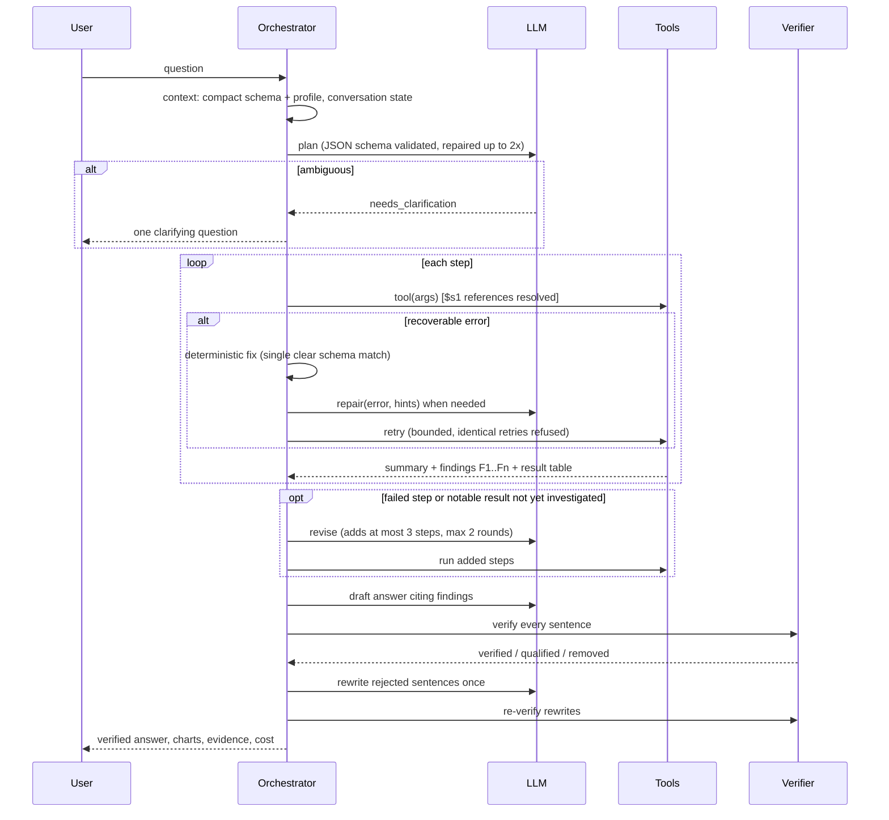

# Agent workflow

The agent runs an explicit plan, execute, observe, revise loop. Only structured artifacts are stored or shown:
plans (goal, steps, tools, arguments, dependencies), step status, tool summaries, findings and verified claims.
Model reasoning is never persisted; `<think>` blocks from reasoning models are stripped at the provider layer.



## Context gathering

`render_schema()` produces a compact description per table: column, type, role, semantic meaning with
confidence (marked `UNCERTAIN` below 0.6), ranges, top categorical values (sanitized, at most 12) and warnings.
PII columns never show values. Raw rows are never sent to the model. A short "exact names" guide is placed next
to the question because small models follow nearby instructions more reliably.

## Fast path

Before planning, `app/agent/fastpath.py` checks whether the question is a simple whole-table statistic ("What is the
average revenue?"): one numeric column, no grouping, filter value, time reference, ranking or comparison, and an
exact (not sample-based) profile. If so, the plan is a single `profile_dataset` step and the answer is written from
the profile finding by a template; it still goes through the verifier. Zero LLM calls; follow-up questions always
use the full agent.

## Scope check

After planning and before any tool runs, `app/agent/scope.py` looks for restrictions the user did not ask for:
filters (tool `filters` and WHERE/HAVING conditions pinning a column to fixed values) whose column and value the
question and conversation context never mention, and period restrictions when the question has no time reference.
Comparisons between two columns (`mrr > initial_mrr`) define the asked-for quantity and are not restrictions. The
planner gets one rescope attempt; remaining issues become visible assumptions (`answer.scope`, assumptions starting
with "Scope:").

## Planning artifacts

```json
{"goal": "Determine causes of the Q3 revenue decline",
 "assumptions": ["Revenue is the sum of the revenue column"],
 "context_update": {"filters": [], "metric": "revenue", "period": "2026-Q3"},
 "steps": [
   {"id": "s1", "title": "Compare Q3 with Q2 by region", "tool": "compare_periods",
    "args": {"metric": {"column": "revenue", "agg": "sum"}, "current_period": "2026-Q3",
             "previous_period": "2026-Q2", "dimension": "region"}, "depends_on": []},
   {"id": "s2", "title": "Chart the change", "tool": "create_chart",
    "args": {"result_id": "$s1", "chart_type": "bar", "x": "region", "y": ["previous", "current"]},
    "depends_on": ["s1"]}]}
```

## Failure recovery

| Situation | Handling |
|---|---|
| Unknown column or table with one clear match (`regions` vs `region`) | Fixed deterministically, recorded as a retry with reason "auto-corrected", no LLM call |
| Other recoverable errors (syntax, KeyError in Python, bad period, invalid chart) | Sanitized error + schema hints sent to the repair prompt; corrected call retried |
| Identical repaired call | Refused (no retry storms) |
| Non-recoverable (sandbox unavailable, resource limits, internal errors) | Step fails, dependents are skipped, failure listed in caveats |
| Limits | `AGENT_MAX_RETRIES_PER_STEP` (default 3; 1 for charts), `AGENT_MAX_STEPS` (12), `AGENT_MAX_REPLANS` (2), job time limit |

Every attempt is a `ToolExecution` row with `attempt`, `retry_of_id` and `retry_reason`.

## Verification

See `app/agent/verifier.py`.

- Numbers are extracted with currency, sign, thousands separators, K/M/B suffixes and percentages.
  Years, ISO dates, quarter labels, finding labels and small integers (counts like "top 3") are exempt.
- A number is supported when it equals a value of a cited finding within the precision the writer used, or
  when a percentage recomputes from two values of the cited findings (percent change or share). The derived
  formula is stored as evidence.
- A finding only supports a sentence that names one of its entities and does not contradict its quarter or month.
- Unsupported sentences are removed (kept with status `removed` for audit). The model gets one chance to restate
  them from the findings; rewrites are verified again.
- Causal wording ("caused", "due to", "driven by"...) in facts moves the sentence to interpretations with the
  prefix "Hypothesis (not causally verified)".
- Charts are rebuilt from their source result table and their data hash compared.

## Conversation memory

`Conversation.state` keeps active filters, metric, dimension, period and the last turns' questions and verified
headlines. The planner sees it and returns `context_update`; users can reset it. Completed analyses are also
embedded (when an embedding endpoint is configured) for `retrieve_previous_analysis`; retrieved numbers are
background only and must be recomputed.
