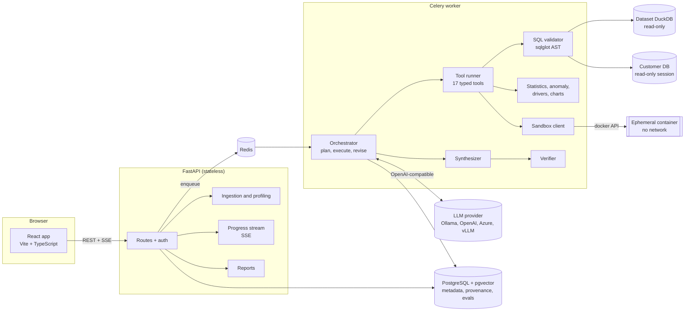

# Architecture

AnalystOS is split into a stateless API, background workers, an application database, and per-execution
sandboxes. The language model is used for planning, argument repair, plan revision and prose; every number
comes from deterministic code.

## Modules

| Module | Path | Responsibility |
|---|---|---|
| API layer | `backend/app/api` | Routes, request/response schemas, auth dependencies, SSE progress stream |
| Auth / users | `app/core/security.py`, `api/routes/auth.py` | Argon2 password hashing, JWT sessions, Fernet encryption of stored DB passwords |
| File ingestion | `app/services/ingestion` | CSV (encoding, delimiter, header, malformed rows) and XLSX (sheets, merged cells, header rows) into DuckDB, type coercion, parquet export |
| Database connections | `app/services/datasources` | Query-engine interface, DuckDB engine, SQLAlchemy engine (PostgreSQL, MySQL, SQLite), introspection |
| Schema + dataset profiler | `app/services/profiling` | Column statistics, roles, duplicates, outliers, PII and prompt-injection flags (computed in DuckDB) |
| Semantic interpreter | `app/services/semantic` | Business meaning per column with confidence, alternatives and an uncertainty flag |
| Agent planner | `app/agent/planner.py` | Plan, repair and revise prompts with schema-validated JSON output |
| Tool router | `app/agent/tools/base.py`, `registry.py` | Typed inputs, validation, error classification, execution logging, metrics |
| SQL security + execution | `app/services/sql` | AST validation, limits, audit log of every statement |
| Python sandbox | `app/services/sandbox`, `sandbox/` | Static checks plus ephemeral Docker execution |
| Statistics | `app/services/analytics/stats.py` | Descriptive stats, confidence intervals, tests, correlation, trend, contribution, price/volume decomposition |
| Anomaly detection | `app/services/analytics/anomaly.py` | z-score, IQR, seasonal rolling baseline (log scale when appropriate), Isolation Forest |
| Root-cause analysis | `app/agent/tools/investigation_tools.py` | Per-dimension contribution, concentration ranking, volume vs price effects |
| Visualization | `app/services/viz/charts.py` | Chart specs built only from stored result tables, hashed for verification |
| Evidence store | `app/db/models/evidence.py` | Result tables, findings, claims, evidence, charts, reports |
| Result verifier | `app/agent/verifier.py` | Number matching, derived percentages, entity and period checks, causal-language guard |
| Report generator | `app/services/reports` | HTML (and PDF with WeasyPrint) reports and Excel result exports |
| Conversation memory | `app/agent/persistence.py`, `models/memory.py` | Conversation state (filters, metric, period, history) and pgvector memory of past analyses |
| Scope check | `app/agent/scope.py` | Finds filters and time windows the question never asked for, before execution |
| Fast path | `app/agent/fastpath.py` | Answers simple whole-table statistics from the profile with no LLM calls |
| Saved metrics | `app/services/metrics.py`, `api/routes/metrics.py` | Team-defined aggregate expressions, validated, used via `compute_metric` |
| Relationships | `app/services/semantic/relationships.py` | Declared and value-verified join keys between tables |
| Access control | `app/api/deps.py`, `api/routes/admin.py` | Roles (admin, analyst, viewer), source sharing, refresh tokens, rate limits |
| Schedules and alerts | `app/services/schedules.py`, `api/routes/schedules.py` | Recurring analyses, anomaly alerts, SSRF-safe webhooks, Celery beat |
| Tracing | `app/core/tracing.py` | OpenTelemetry spans for analyses, LLM calls, tools, SQL and sandboxes |
| Sandbox backends | `app/services/sandbox/` | Docker (default, optional gVisor runtime) or Modal sandboxes |
| Evaluation | `backend/evals` | Deterministic benchmark data, 67 cases, scorers, repeated/parallel runner, model comparison |
| Observability | `app/core/logging.py`, `app/core/metrics.py` | Structured JSON logs with request/analysis/user context, Prometheus metrics |
| Background jobs | `app/workers` | Celery tasks, inline dispatch for tests, stale-job reaper |

## Request lifecycle of one question

1. `POST /api/conversations/{id}/ask` stores the question, creates an `Analysis` (status `queued`) and enqueues it.
2. A worker runs `AnalysisRunner.run()` (see [agent workflow](agent-workflow.md)).
3. Progress events are written in their own transactions; `GET /api/analyses/{id}/stream` relays them as SSE.
4. The final answer, verified claims, evidence links, charts and costs are persisted and fetched by the UI.

## Why these choices

- **DuckDB per dataset version.** Uploaded files become a read-only DuckDB database: SQL works on uploads
  exactly as on external databases, large CSVs stream without pandas, and the file is opened with external
  access disabled and configuration locked.
- **One validator for all SQL.** Tool-generated aggregation SQL and model-written SQL pass the same AST
  validator and the same audit log, so every number has a stored, re-runnable query.
- **Findings as the only source of numbers.** Tools emit structured findings (value, formula, entities,
  periods). The model cites them; the verifier rejects any number it cannot trace.
- **Postgres polling for SSE.** Events are durable rows. The stream survives worker restarts and API
  replicas without sticky sessions; Redis is only the job queue.
- **Provider abstraction.** The agent depends on `LLMProvider`; the OpenAI-compatible client covers OpenAI,
  Azure OpenAI, Ollama, vLLM and LM Studio through configuration.

## Deployment shapes

- **Docker Compose (local or a single VM):** API, worker (thread pool), beat, Postgres, Redis, sandbox image, frontend;
  `docker-compose.observability.yml` adds Prometheus, Grafana and Jaeger.
- **Platform hosts without Docker (Render, Fly, Railway):** `SANDBOX_BACKEND=modal` runs generated Python in Modal
  sandboxes and `RUN_ANALYSES_INLINE=true` runs analyses in the API process for a single-service demo. See
  [deployment](deployment.md).

## Extending

- **New database** (SQL Server, Snowflake, BigQuery): add a dialect branch in `sql_engine.build_url` (or a new
  `QueryEngine` subclass) and map its sqlglot dialect; validation, tools and the agent are unchanged.
- **New tool**: subclass `Tool` with a pydantic `Input`, return `ToolResult` with findings, register it in
  `tools/registry.py`. It appears in the planner's catalog automatically.
