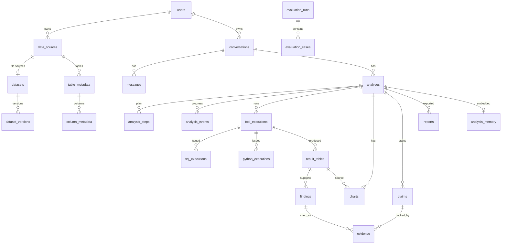

# Database schema

Application data lives in PostgreSQL (pgvector image). Migrations: `backend/alembic` (`alembic upgrade head`).
Uploaded datasets themselves are stored as DuckDB files plus parquet exports under `DATA_DIR/datasets/<id>/v<n>/`.

| Table | Purpose / key columns |
|---|---|
| `users` | email, argon2 password hash, admin flag |
| `data_sources` | kind (`file`, `postgresql`, `mysql`, `sqlite`), connection fields, `password_encrypted` (Fernet), schema, `allowed_tables`, `restricted_columns`, status |
| `datasets`, `dataset_versions` | original file, type, size; version storage paths, sha256, ingestion report (encoding, delimiter, rejected rows, coercions, warnings) |
| `table_metadata` | table/sheet, row and column counts, profile (duplicates, missing, warnings), semantic schema |
| `column_metadata` | physical and inferred type, role, semantic type + confidence + source (rules/user), PII flag, statistics |
| `conversations`, `messages` | conversation state (filters, metric, dimension, period, history) and the transcript |
| `analyses` | question, status, plan, answer (headline, caveats, assumptions, verification and tool stats), model, tokens, LLM calls, cost, latency, replans |
| `analysis_steps` | plan steps with tool, dependencies, status, `added_by_replan`, result summary |
| `analysis_events` | append-only progress feed for SSE (no model reasoning) |
| `tool_executions` | tool, input, output, status, error kind, attempt, `retry_of_id`, `retry_reason`, duration |
| `sql_executions` | original SQL, executed (limited) SQL, validation result, status (`success`, `blocked`, `error`, `timeout`), rows, duration |
| `python_executions` | code, static check, status, exit code, stdout/stderr, artifacts, resource limits |
| `result_tables` | columns and rows (capped) produced by a tool, with source (SQL id, filters, periods) |
| `findings` | deterministic facts F1..Fn: statement, numeric values, formula, entities, periods |
| `charts` | type, spec (including build arguments), data, data hash, verified flag |
| `claims` | sentence, section, kind (fact/interpretation/recommendation), status, numbers, verification detail, original text |
| `evidence` | claim to finding link with values, formula (including derived formulas), source type |
| `reports` | rendered HTML and structured content |
| `analysis_memory` | analysis summary + `vector(768)` embedding (HNSW cosine index) |
| `evaluation_runs`, `evaluation_cases` | benchmark runs, metrics, per-case expected/answer/scores |
